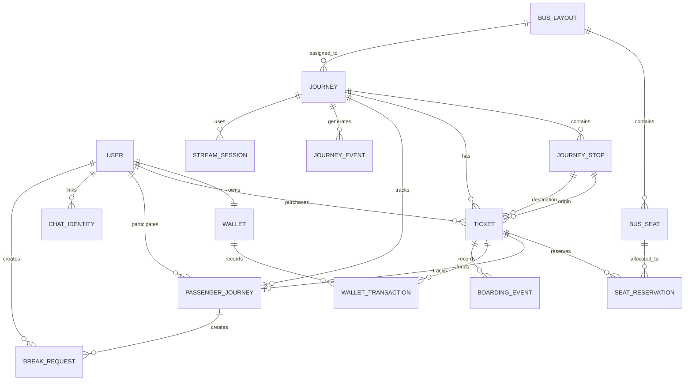

# RogueRPM Passenger System
## Product Requirements Document (PRD) & Database Architecture

**Version:** 1.0  
**Product type:** Interactive livestream passenger management platform  
**Primary game:** Euro Truck Simulator 2 – Coaches  
**Streaming platform:** YouTube  
**Initial vehicle capacity:** 42 passengers  
**Currency:** Virtual tokens

---

# PART 1 — PRODUCT OVERVIEW

## 1. Product vision

Create an interactive virtual coach travel experience where YouTube livestream viewers can register, earn virtual tokens, purchase tickets, select seats, board a virtual bus, request breaks and participate in journeys alongside the streamer.

The platform has three primary interfaces:

1. Passenger portal.
2. Operator and moderator dashboard.
3. Live OBS overlay.

All three interfaces communicate through a common backend.

## 2. Product objectives

- Increase audience engagement during livestreams.
- Give viewers a reason to return to future streams.
- Introduce gamification through virtual currency and achievements.
- Automate passenger and seat management.
- Make livestream interactions visible to the audience.
- Create a persistent passenger identity and journey history.

## 3. User roles

| Role | Permissions |
|---|---|
| Passenger | Book tickets, select seats, check in, request breaks |
| Operator | Create journeys, control stops, approve exceptional actions, control breaks |
| Moderator | Monitor passengers, assist with verification and manage reported issues |
| Administrator | Manage users, avatars, tokens, configurations and platform settings |

The operator should have all moderator permissions.

---

# PART 2 — FUNCTIONAL REQUIREMENTS

## 4. Authentication and passenger profiles

### FR-001: Registration

Passengers must be able to register using:
- Google authentication.
- YouTube account linking.
- Username and password as an optional future alternative.

Recommended initial implementation: Google OAuth.

YouTube account linking should associate the passenger's website account with their YouTube channel identity.

### FR-002: Passenger profile

Each passenger has:

- Unique user ID.
- Username.
- Display name.
- Avatar.
- YouTube channel ID (if linked).
- Registration date.
- Wallet balance.
- Journey statistics.
- Achievement badges.
- Account status.

### FR-003: Initial token allocation

Every newly registered passenger receives 1,000 tokens.

Rules:
- Initial allocation happens exactly once.
- Users cannot repeatedly receive the welcome bonus.
- Every token transaction is recorded.
- Tokens cannot be transferred between passengers in MVP.
- Negative wallet balances are prohibited.

---

## 5. Journey management

### FR-004: Create journey

The operator can create a journey with:

- Journey name.
- Journey description.
- ETS2 starting location.
- Final destination.
- Vehicle/bus configuration.
- Departure date and time.
- Ticket price.
- Boarding window.
- Intermediate stops.
- Mandatory break configuration.
- Optional break allowance.
- Journey status.

### FR-005: Journey stops

Each journey contains ordered stops.

Example:

| Stop | Location | Sequence |
|---|---|---:|
| 1 | Reykjavik | 1 |
| 2 | Akureyri | 2 |
| 3 | Egilsstadir | 3 |
| 4 | Hofn | 4 |
| 5 | Vik | 5 |

The operator can configure the stops before publishing the journey.

Once tickets are purchased, stop modifications should be restricted. Changes that affect existing tickets require an explicit operator confirmation.

### FR-006: Journey lifecycle

Journey states:

- DRAFT
- SCHEDULED
- BOOKING_OPEN
- BOARDING
- IN_PROGRESS
- PAUSED
- COMPLETED
- CANCELLED

Only one journey can be in an operational state at a time.

Operational states:

- BOOKING_OPEN
- BOARDING
- IN_PROGRESS
- PAUSED

Enforce this in PostgreSQL, not just in frontend logic.

---

## 6. Ticket booking

### FR-007: Ticket purchase

Passengers can:

1. Select an available journey.
2. Select an origin.
3. Select a destination.
4. View the ticket price.
5. Confirm purchase.
6. Receive a digital ticket.

The origin must precede the destination.

A ticket is valid only for its selected journey segment.

Example:

- Passenger A: Reykjavik → Akureyri.
- Passenger B: Reykjavik → Egilsstadir.
- Passenger C: Akureyri → Hofn.

### FR-008: Ticket pricing

Initial pricing can be configured by the operator.

Example:

| Journey distance | Ticket price |
|---|---:|
| One segment | 100 tokens |
| Two segments | 150 tokens |
| Three segments | 200 tokens |
| Four segments | 250 tokens |

These are illustrative prices, not fixed business rules.

For MVP, support a simple operator-configured pricing formula or fixed ticket price.

### FR-009: Ticket information

Every ticket contains:

- Ticket ID.
- Ticket number.
- Passenger ID.
- Journey ID.
- Origin stop.
- Destination stop.
- Purchase price.
- Booking timestamp.
- Ticket status.
- Check-in status.
- Seat assignment (when selected).

Ticket statuses:

- CONFIRMED
- CHECKED_IN
- BOARDED
- COMPLETED
- NO_SHOW
- CANCELLED
- LEFT_BEHIND

Keep break status separate from ticket status.

### FR-010: Seat selection

Passengers can select an available seat after purchasing a ticket.

Requirements:
- Display the 42-seat layout.
- Display seat availability in real time.
- Prevent two passengers from reserving overlapping journey segments on the same seat.
- Allow seat changes before boarding, subject to availability.
- Release seats after passengers disembark.
- Maintain historical seat allocation records.

A seat can be occupied by different passengers during different portions of the same journey.

---

## 7. Passenger check-in and boarding

### FR-011: Automated check-in

Since you selected self-verification, the passenger should be able to check in independently.

Recommended flow:

1. Passenger logs into the website.
2. Opens their ticket.
3. Selects CHECK IN.
4. Backend validates ticket and boarding eligibility.
5. Passenger receives a boarding confirmation.
6. Seat becomes occupied.
7. Avatar appears on the live seat map.

An authenticated account should be the primary identity verification mechanism.

If you retain boarding codes, generate random, short-lived, single-use codes. Never expose private verification codes in public chat.

### FR-012: Boarding eligibility

A passenger can board only when:

- Ticket is valid.
- Journey is in BOARDING state, or the operator has opened boarding at an intermediate stop.
- Passenger is at their designated origin stop.
- Passenger has checked in.
- Seat reservation is valid.

### FR-013: No-show handling

If a passenger doesn't check in before the boarding deadline:

- Ticket status becomes NO_SHOW.
- Seat reservation is released.
- Ticket remains in passenger history.
- No-show statistics are updated.

The operator can configure the boarding deadline.

---

## 8. Intermediate stop management

### FR-014: Stop arrival

The operator manually marks arrival at a stop in MVP.

The system then:

1. Identifies passengers whose destination is the current stop.
2. Marks their journey segment completed.
3. Releases their seats.
4. Opens boarding for passengers originating at this stop.
5. Updates the live passenger manifest.

### FR-015: Stop departure

Before departure:

- New boarding is closed.
- Passenger manifest is refreshed.
- Occupied seats are confirmed.
- Operator can resume the journey.

Passengers cannot board at a stop that the vehicle has already passed.

---

## 9. Break management

### FR-016: Mandatory breaks

The operator configures mandatory breaks.

Default configuration:

- One break every 150 minutes.
- Duration: operator configurable.
- Applies to all passengers currently onboard.
- Does not consume personal break credits.

The system can display the next scheduled break.

### FR-017: Personal breaks

Each passenger receives two personal break credits per journey.

A passenger can request a break using the website.

Break lifecycle:

1. REQUESTED
2. ACCEPTED
3. BREAK_STARTED
4. RETURNED

Alternative terminal states:

- REJECTED
- EXPIRED
- LEFT_BEHIND
- CANCELLED

### FR-018: Personal break timer

Default configuration:

| Setting | Duration |
|---|---:|
| Break duration | 120 seconds |
| Grace period | 30 seconds |

The timer starts when the operator confirms that the vehicle has stopped.

Not when the passenger initially presses REQUEST BREAK.

Passenger can press I'M BACK during the break.

If the passenger doesn't return within 120 seconds:

- Grace period begins.
- A warning appears.
- If they still don't return, status becomes LEFT_BEHIND.
- Passenger is removed from the active onboard manifest.
- Seat becomes available according to segment allocation rules.

The operator can extend the timer or override the result.

### FR-019: Break request restrictions

- Only one active passenger-requested break at a time.
- A passenger cannot have multiple pending requests.
- A passenger cannot exceed two personal break credits.
- The operator can reject requests.
- Mandatory breaks do not consume personal credits.

---

## 10. YouTube integration

### FR-020: YouTube Live Chat

Integrate with YouTube Live Chat using the official YouTube Data API.

The system should associate the current journey with the active YouTube livestream.

Suggested commands:

| Command | Action |
|---|---|
| !ticket | Show booking link |
| !journey | Show current journey |
| !seat | Show passenger seat |
| !status | Show passenger status |
| !break | Show break request instructions |
| !wallet | Show token balance |
| !leaderboard | Show top passengers |

For authenticated and linked passengers, selected commands can initiate website actions.

However, website authentication remains the authority for sensitive operations.

The system must:
- Ignore duplicate messages.
- Prevent command spam.
- Handle disconnected livestreams.
- Handle API quota and polling limits.
- Maintain YouTube channel identity mapping.

---

## 11. OBS overlay

### FR-021: Live HUD

Provide a dedicated public, read-only browser URL.

Example:

`/overlay/journey/{journeyId}`

Display:

1. Journey name.
2. Starting location.
3. Current location.
4. Next destination.
5. Journey progress.
6. Passenger count.
7. 42-seat diagram.
8. Passenger avatars.
9. Passenger names.
10. Break notifications.
11. Recent boarding announcements.

### FR-022: Seat visual states

| State | Display |
|---|---|
| Available | Empty seat |
| Reserved | Booked indicator |
| Occupied | Passenger avatar |
| Disembarked | Empty seat |
| No-show | No passenger avatar |

The overlay should update automatically using WebSockets.

Do not expose private ticket codes or personal account information on the overlay.

---

## 12. Passenger dashboard

### FR-023: Passenger home page

Display:

- Profile and avatar.
- Token balance.
- Active ticket.
- Upcoming journey.
- Boarding status.
- Selected seat.
- Break credits remaining.
- Journey history.
- Achievements.

### FR-024: Journey history

Every completed or interrupted journey should be recorded.

Example:

| Journey | Route | Result |
|---|---|---|
| #001 | Reykjavik → Akureyri | Completed |
| #002 | Akureyri → Hofn | Left behind |
| #003 | Hofn → Vik | No-show |

---

# PART 3 — DATABASE ARCHITECTURE

## 13. Recommended technology

| Layer | Technology |
|---|---|
| Application | Next.js |
| Language | TypeScript |
| UI | React + Tailwind CSS |
| Database | PostgreSQL |
| ORM | Prisma |
| Authentication | Auth.js |
| Realtime | Socket.IO |
| Cache | Redis (optional initially) |
| Validation | Zod |
| Hosting | Vercel |
| Streaming overlay | OBS Browser Source |

The architecture should be a modular monolith initially.

Separate business domains into modules rather than creating microservices.

## 14. Database entities

The proposed database contains these domains.

### Identity and authentication
- User
- Account
- Session
- Avatar
- ChatIdentity

### Journey management
- Journey
- JourneyStop
- BusLayout
- BusSeat

### Ticketing and boarding
- Ticket
- SeatReservation
- BoardingEvent

### Wallet
- Wallet
- WalletTransaction

### Passenger operations
- PassengerJourney
- BreakRequest
- BreakCreditTransaction

### Streaming and system management
- StreamSession
- ChatCommandLog
- JourneyEvent
- AuditLog

## 15. Entity relationship diagram



## 16. Detailed table design

### 16.1 users

Stores passenger and staff accounts.

| Column | Type | Description |
|---|---|---|
| id | UUID | Primary key |
| username | VARCHAR(30) | Unique username |
| display_name | VARCHAR(60) | Public name |
| email | VARCHAR(255) | Account email |
| avatar_id | UUID | Selected avatar |
| role | ENUM | PASSENGER, MODERATOR, OPERATOR, ADMIN |
| status | ENUM | ACTIVE, SUSPENDED, DELETED |
| created_at | TIMESTAMP | Registration time |
| updated_at | TIMESTAMP | Last update |

Unique constraints:
- username
- email (when present)

### 16.2 avatars

Stores the available system avatars.

| Column | Type |
|---|---|
| id | UUID |
| name | VARCHAR |
| image_url | TEXT |
| is_active | BOOLEAN |
| created_at | TIMESTAMP |

Initially, provide 20–30 predefined avatars.

### 16.3 chat_identities

Links a website user to their YouTube identity.

| Column | Type |
|---|---|
| id | UUID |
| user_id | UUID |
| platform | ENUM |
| platform_user_id | VARCHAR |
| platform_username | VARCHAR |
| linked_at | TIMESTAMP |

Unique constraint:

`(platform, platform_user_id)`

A YouTube channel must not be linked to multiple passenger accounts.

### 16.4 wallets

One wallet per user.

| Column | Type |
|---|---|
| id | UUID |
| user_id | UUID |
| balance | BIGINT |
| created_at | TIMESTAMP |
| updated_at | TIMESTAMP |

Initial balance: 1,000 tokens.

The balance is a cached current balance. The transaction ledger remains the financial source of truth.

### 16.5 wallet_transactions

An immutable transaction ledger.

| Column | Type |
|---|---|
| id | UUID |
| wallet_id | UUID |
| amount | BIGINT |
| transaction_type | ENUM |
| reference_type | VARCHAR |
| reference_id | UUID |
| idempotency_key | VARCHAR |
| description | TEXT |
| created_at | TIMESTAMP |

Transaction types:

- INITIAL_BONUS
- TICKET_PURCHASE
- TICKET_REFUND
- REWARD
- ADMIN_CREDIT
- ADMIN_DEBIT
- EVENT_REWARD

Rules:
- Positive amount = credit.
- Negative amount = debit.
- Never modify historical transactions.
- Every transaction has a unique idempotency key.

### 16.6 bus_layouts

Defines the vehicle seating configuration.

| Column | Type |
|---|---|
| id | UUID |
| name | VARCHAR |
| capacity | INTEGER |
| layout_json | JSONB |
| is_active | BOOLEAN |

Example:

`Luxury Coach - 42 Seats`

The JSON layout stores the visual arrangement, including seat coordinates, rows, columns and aisle position.

### 16.7 bus_seats

Individual seats belonging to a bus layout.

| Column | Type |
|---|---|
| id | UUID |
| bus_layout_id | UUID |
| seat_number | VARCHAR |
| row_number | INTEGER |
| column_number | INTEGER |
| seat_type | ENUM |
| is_bookable | BOOLEAN |

Unique constraint:

`(bus_layout_id, seat_number)`

### 16.8 journeys

The main journey record.

| Column | Type |
|---|---|
| id | UUID |
| journey_number | BIGINT |
| name | VARCHAR |
| description | TEXT |
| bus_layout_id | UUID |
| status | ENUM |
| ticket_price | BIGINT |
| break_interval_minutes | INTEGER |
| personal_break_limit | INTEGER |
| personal_break_seconds | INTEGER |
| grace_period_seconds | INTEGER |
| current_stop_id | UUID |
| departure_at | TIMESTAMP |
| started_at | TIMESTAMP |
| completed_at | TIMESTAMP |
| created_by | UUID |
| created_at | TIMESTAMP |

Only one operational journey should exist at any time.

### 16.9 journey_stops

Stores ordered stops.

| Column | Type |
|---|---|
| id | UUID |
| journey_id | UUID |
| sequence | INTEGER |
| name | VARCHAR |
| location_description | TEXT |
| latitude | DECIMAL |
| longitude | DECIMAL |
| arrival_at | TIMESTAMP |
| departed_at | TIMESTAMP |
| status | ENUM |

Unique constraint:

`(journey_id, sequence)`

### 16.10 tickets

Represents the passenger's purchase.

| Column | Type |
|---|---|
| id | UUID |
| ticket_number | VARCHAR |
| journey_id | UUID |
| user_id | UUID |
| origin_stop_id | UUID |
| destination_stop_id | UUID |
| price_paid | BIGINT |
| status | ENUM |
| purchased_at | TIMESTAMP |
| checked_in_at | TIMESTAMP |
| boarded_at | TIMESTAMP |
| completed_at | TIMESTAMP |

Important constraints:

- Origin and destination must belong to the same journey.
- Origin sequence must be lower than destination sequence.
- Only one active ticket per passenger per journey in MVP.
- A completed ticket cannot become active again.

### 16.11 seat_reservations

This is one of the most important tables.

It tracks seat allocation across journey segments.

| Column | Type |
|---|---|
| id | UUID |
| ticket_id | UUID |
| journey_id | UUID |
| seat_id | UUID |
| from_sequence | INTEGER |
| to_sequence | INTEGER |
| status | ENUM |
| reserved_until | TIMESTAMP |
| created_at | TIMESTAMP |
| released_at | TIMESTAMP |

Reservation statuses:

- HELD
- CONFIRMED
- OCCUPIED
- RELEASED
- EXPIRED

Example:

Passenger A occupies Seat 12 from stop 1 to stop 3.

Passenger B can reserve Seat 12 from stop 3 to stop 5.

But Passenger C cannot reserve Seat 12 from stop 2 to stop 4.

The backend must enforce this using PostgreSQL transactions and an overlap constraint.

Recommended PostgreSQL constraint using `btree_gist`:

```sql
CREATE EXTENSION IF NOT EXISTS btree_gist;

ALTER TABLE seat_reservations
ADD CONSTRAINT no_overlapping_seat_reservations
EXCLUDE USING gist (
  journey_id WITH =,
  seat_id WITH =,
  int4range(from_sequence, to_sequence, '[)') WITH &&
)
WHERE (status IN ('HELD', 'CONFIRMED', 'OCCUPIED'));
```

This prevents overlapping reservations for the same seat on the same journey.

An expired or released reservation no longer blocks the seat.

### 16.12 passenger_journeys

Tracks the passenger's actual participation.

This is separate from ticket ownership.

| Column | Type |
|---|---|
| id | UUID |
| ticket_id | UUID |
| user_id | UUID |
| journey_id | UUID |
| status | ENUM |
| actual_boarded_at | TIMESTAMP |
| actual_disembarked_at | TIMESTAMP |
| current_stop_id | UUID |
| created_at | TIMESTAMP |

Passenger statuses:

- BOOKED
- CHECKED_IN
- ONBOARD
- COMPLETED
- NO_SHOW
- LEFT_BEHIND
- CANCELLED

This table is essential for accurate passenger statistics.

### 16.13 boarding_events

Maintains an auditable record of boarding activity.

| Column | Type |
|---|---|
| id | UUID |
| ticket_id | UUID |
| user_id | UUID |
| stop_id | UUID |
| event_type | ENUM |
| timestamp | TIMESTAMP |
| metadata | JSONB |

Event types:

- CHECK_IN
- BOARDED
- DISEMBARKED
- NO_SHOW
- REJECTED

### 16.14 break_requests

Tracks personal and mandatory break operations.

| Column | Type |
|---|---|
| id | UUID |
| journey_id | UUID |
| passenger_journey_id | UUID |
| break_type | ENUM |
| status | ENUM |
| requested_at | TIMESTAMP |
| accepted_at | TIMESTAMP |
| started_at | TIMESTAMP |
| deadline_at | TIMESTAMP |
| grace_deadline_at | TIMESTAMP |
| returned_at | TIMESTAMP |
| completed_at | TIMESTAMP |

Break types:

- PERSONAL
- MANDATORY

For mandatory breaks, passenger_journey_id can be null because the break applies to the whole bus.

### 16.15 break_credit_transactions

An immutable record of personal break credits.

| Column | Type |
|---|---|
| id | UUID |
| passenger_journey_id | UUID |
| break_request_id | UUID |
| amount | INTEGER |
| transaction_type | ENUM |
| created_at | TIMESTAMP |

Example:

- Initial allowance: +2.
- Personal break request accepted: -1.
- Additional operator-granted credit: +1.

This makes the allowance configurable and auditable.

### 16.16 stream_sessions

Represents a YouTube livestream associated with a journey.

| Column | Type |
|---|---|
| id | UUID |
| journey_id | UUID |
| platform | ENUM |
| broadcast_id | VARCHAR |
| live_chat_id | VARCHAR |
| status | ENUM |
| started_at | TIMESTAMP |
| ended_at | TIMESTAMP |

### 16.17 chat_command_logs

Stores processed chat commands.

| Column | Type |
|---|---|
| id | UUID |
| stream_session_id | UUID |
| platform_message_id | VARCHAR |
| platform_user_id | VARCHAR |
| command | VARCHAR |
| response | TEXT |
| processed_at | TIMESTAMP |

Unique constraint:

`(stream_session_id, platform_message_id)`

This prevents duplicate processing.

### 16.18 journey_events

A general event history.

| Column | Type |
|---|---|
| id | UUID |
| journey_id | UUID |
| event_type | VARCHAR |
| actor_id | UUID |
| payload | JSONB |
| created_at | TIMESTAMP |

Examples:

- JOURNEY_CREATED
- BOOKING_OPENED
- PASSENGER_BOARDED
- PASSENGER_LEFT
- BREAK_STARTED
- STOP_REACHED
- JOURNEY_COMPLETED

This table can power the passenger history, activity feed and OBS announcements.

### 16.19 audit_logs

Records important administrative operations.

| Column | Type |
|---|---|
| id | UUID |
| actor_id | UUID |
| action | VARCHAR |
| entity_type | VARCHAR |
| entity_id | UUID |
| old_values | JSONB |
| new_values | JSONB |
| created_at | TIMESTAMP |

Use this for sensitive actions such as:
- Token adjustments.
- Ticket cancellations.
- Manual passenger removal.
- Seat reassignment.
- Journey cancellation.

---

# PART 4 — IMPORTANT DATABASE RULES

## 17. Data integrity

The following rules must be enforced at the backend/database level.

| Rule | Enforcement |
|---|---|
| One active journey | Partial unique index |
| Unique usernames | Database unique constraint |
| One wallet per user | Unique foreign key |
| No negative tokens | Transactional wallet updates |
| No duplicate seat allocation | PostgreSQL exclusion constraint |
| Valid journey segment | Stop sequence validation |
| No duplicate check-in | Idempotency key |
| No duplicate chat processing | Unique message ID |
| No duplicate personal break | Transactional validation |
| Valid passenger ownership | Foreign keys and authorization |

## 18. Token transaction safety

Ticket purchases must execute in a single database transaction.

Pseudocode:

```typescript
await prisma.$transaction(async (tx) => {
  const wallet = await tx.wallet.findUnique({
    where: { userId },
  });

  if (!wallet || wallet.balance < ticketPrice) {
    throw new Error("Insufficient tokens");
  }

  await tx.wallet.update({
    where: { userId },
    data: {
      balance: { decrement: ticketPrice },
    },
  });

  await tx.walletTransaction.create({
    data: {
      walletId: wallet.id,
      amount: -ticketPrice,
      transactionType: "TICKET_PURCHASE",
      idempotencyKey,
    },
  });

  await tx.ticket.create({
    data: {
      userId,
      journeyId,
      originStopId,
      destinationStopId,
      pricePaid: ticketPrice,
      status: "CONFIRMED",
    },
  });
});
```

Production implementation must additionally:
- Lock the wallet row or use an atomic conditional update.
- Enforce idempotency.
- Roll back the entire operation if any step fails.
- Validate the journey and stop availability inside the transaction.

Never deduct tokens on the frontend.

---

# PART 5 — APPLICATION ARCHITECTURE

## 19. Suggested project structure

```text
roguerpm-passenger/
│
├── apps/
│   └── web/
│       ├── src/
│       │   ├── app/
│       │   │   ├── (public)/
│       │   │   │   ├── page.tsx
│       │   │   │   └── journeys/
│       │   │   │
│       │   │   ├── passenger/
│       │   │   │   ├── dashboard/
│       │   │   │   ├── tickets/
│       │   │   │   ├── wallet/
│       │   │   │   └── history/
│       │   │   │
│       │   │   ├── operator/
│       │   │   │   ├── dashboard/
│       │   │   │   ├── journeys/
│       │   │   │   ├── passengers/
│       │   │   │   ├── seats/
│       │   │   │   └── breaks/
│       │   │   │
│       │   │   ├── moderator/
│       │   │   │
│       │   │   ├── overlay/
│       │   │   │   └── [journeyId]/
│       │   │   │
│       │   │   └── api/
│       │   │
│       │   ├── server/
│       │   │   ├── modules/
│       │   │   │   ├── auth/
│       │   │   │   ├── users/
│       │   │   │   ├── wallet/
│       │   │   │   ├── journeys/
│       │   │   │   ├── ticketing/
│       │   │   │   ├── seats/
│       │   │   │   ├── boarding/
│       │   │   │   ├── breaks/
│       │   │   │   ├── youtube/
│       │   │   │   └── overlay/
│       │   │   │
│       │   │   └── realtime/
│       │   │
│       │   └── components/
│       │
│       └── prisma/
│           ├── schema.prisma
│           └── migrations/
│
├── packages/
│   ├── shared/
│   ├── validation/
│   └── types/
│
└── README.md
```

## 20. Backend modules

Each module should own its business logic.

| Module | Responsibility |
|---|---|
| Auth | Authentication and roles |
| Users | Profiles and avatars |
| Wallet | Token ledger |
| Journeys | Journey creation and stops |
| Ticketing | Ticket purchases |
| Seats | Reservation and allocation |
| Boarding | Check-in and passenger status |
| Breaks | Break credits and timers |
| YouTube | Live Chat integration |
| Realtime | Socket.IO events |
| Overlay | Stream-facing data |

Avoid putting all business logic inside Next.js route handlers.

Route handlers should validate requests and delegate to the corresponding service.

---

# PART 6 — REALTIME EVENT ARCHITECTURE

## 21. WebSocket events

The backend should publish events when something changes.

| Event | Trigger | Recipients |
|---|---|---|
| journey.updated | Journey changes | All interfaces |
| booking.created | Ticket purchased | Operator, passenger |
| seat.updated | Seat allocated/released | All interfaces |
| passenger.checked_in | Passenger check-in | Operator, overlay |
| passenger.boarded | Boarding confirmed | All interfaces |
| passenger.disembarked | Stop reached | All interfaces |
| break.requested | Passenger requests break | Operator |
| break.started | Operator starts break | All interfaces |
| break.returned | Passenger returns | All interfaces |
| break.expired | Timer expires | Operator, passenger |
| stop.arrived | Operator marks arrival | All interfaces |
| journey.completed | Final destination reached | All interfaces |

Use authenticated private channels for passenger-specific events.

The OBS overlay should subscribe only to public journey information.

## 22. Example event payload

```json
{
  "event": "passenger.boarded",
  "journeyId": "journey-uuid",
  "passenger": {
    "username": "RoadExplorer",
    "avatarUrl": "/avatars/avatar-01.png"
  },
  "seat": {
    "number": "12"
  },
  "timestamp": "2026-11-26T16:30:00Z"
}
```

The server generates this event after the database transaction succeeds.

Never allow clients to directly publish authoritative seat or boarding events.

---

# PART 7 — USER INTERFACE REQUIREMENTS

## 23. Passenger website pages

| Page | Features |
|---|---|
| Landing | Active journey, booking CTA |
| Login | Google authentication |
| Dashboard | Profile, tokens, active ticket |
| Journey details | Stops, pricing, availability |
| Booking | Origin, destination and confirmation |
| Seat selection | Interactive 42-seat diagram |
| Ticket | Ticket details and check-in |
| Break management | Request break and return |
| Wallet | Transaction history |
| Journey history | Completed and interrupted journeys |
| Leaderboard | Passenger rankings |

## 24. Operator dashboard

The operator dashboard should have these sections:

**Journey overview**
- Current journey.
- Current location.
- Next stop.
- Journey status.
- Passenger count.

**Passenger manifest**
- Username.
- Avatar.
- Ticket.
- Origin.
- Destination.
- Seat.
- Passenger status.

**Seat management**
- 42-seat live layout.
- Manual seat reassignment.
- Passenger details.
- Occupancy information.

**Break management**
- Pending requests.
- Active break timer.
- Grace timer.
- Passenger return status.

**Journey controls**
- Open booking.
- Start boarding.
- Start journey.
- Pause journey.
- Mark stop arrival.
- Open intermediate boarding.
- Resume journey.
- Complete journey.

---

# PART 8 — SECURITY AND RELIABILITY

## 25. Security requirements

- Server-side role-based access control.
- Validate ownership of every ticket.
- Never trust client-side token balances.
- Never trust client-side seat availability.
- Protect operator and moderator routes.
- Use secure OAuth sessions.
- Store YouTube credentials securely.
- Rate-limit booking and break requests.
- Validate all inputs with Zod.
- Prevent duplicate API operations using idempotency keys.
- Restrict public overlay data.
- Maintain audit logs.

## 26. Reliability requirements

- Database is the source of truth.
- WebSocket reconnect should restore current state.
- Timers must be calculated using server timestamps.
- Refreshing the page must not reset break timers.
- Stream disconnection must not destroy the journey.
- Operator disconnection should pause automated journey operations.
- All important operations should be recoverable after server restart.

Do not use frontend JavaScript timers as the authoritative timer mechanism. Store deadlines in PostgreSQL and calculate remaining time from server time.

---

# PART 9 — MVP ACCEPTANCE CRITERIA

The MVP is ready for its first public test when all these conditions pass.

### Authentication
- [ ] User can register.
- [ ] User receives 1,000 tokens exactly once.
- [ ] User can select an avatar.
- [ ] User can link a YouTube identity.

### Journey
- [ ] Operator can create a journey.
- [ ] Operator can configure multiple stops.
- [ ] Only one operational journey can be active.

### Ticketing
- [ ] User can purchase a ticket.
- [ ] Tokens are deducted correctly.
- [ ] User can select an origin and destination.
- [ ] User can select an available seat.
- [ ] Overlapping seat reservations are rejected.

### Boarding
- [ ] Passenger can check in independently.
- [ ] Seat occupancy updates in realtime.
- [ ] No-show passengers are handled.
- [ ] Passengers can disembark at intermediate stops.
- [ ] Seats are released correctly.

### Breaks
- [ ] Two personal break credits are allocated.
- [ ] Passenger can request a break.
- [ ] Operator can start the break.
- [ ] Two-minute countdown works.
- [ ] Thirty-second grace period works.
- [ ] Passenger return updates the system.

### Streaming
- [ ] OBS overlay loads.
- [ ] All 42 seats render correctly.
- [ ] Passenger avatars appear.
- [ ] Seat changes update without refreshing.
- [ ] Current journey information appears.
- [ ] YouTube chat commands work.

---

# PART 10 — DEVELOPMENT ROADMAP

| Sprint | Deliverable |
|---|---|
| 1 | Project setup, authentication, database |
| 2 | Passenger profiles and wallet |
| 3 | Journey creation and stop management |
| 4 | Ticket purchasing and segment allocation |
| 5 | Seat map and reservation management |
| 6 | Boarding and passenger manifests |
| 7 | Break management |
| 8 | Realtime event system |
| 9 | OBS overlay |
| 10 | YouTube Chat integration |
| 11 | Testing, security and deployment |

Prioritize functional completeness over decorative features.

The first objective is a working journey with real passengers, not a perfect-looking dashboard.

---

# PART 11 — FUTURE EXTENSIONS

These are deliberately outside the initial MVP:

1. ETS2 telemetry integration.
2. Automatic location and route progress detection.
3. Text-to-speech passenger announcements.
4. Automatic passenger boarding notifications.
5. Achievements and passenger levels.
6. VIP cosmetics and special avatars.
7. Community competitions.
8. Passenger loyalty rewards.
9. Multiple bus types and capacities.
10. Multiple simultaneous operators.
11. Automated route generation.
12. Passenger statistics and historical journey analytics.

---

# FINAL ARCHITECTURAL DECISIONS

| Decision | Selected approach |
|---|---|
| Product | RogueRPM Passenger System |
| Streaming | YouTube |
| Booking | Website + chat integration |
| Authentication | Google OAuth |
| Passenger capacity | 42 initially |
| Journey model | One active journey |
| Stops | Multiple, with segment-based tickets |
| Currency | Virtual token ledger |
| Initial wallet | 1,000 tokens |
| Boarding | Automated self-check-in |
| Seat allocation | Segment-aware reservations |
| Breaks | Two personal credits per journey |
| Realtime | Socket.IO |
| Database | PostgreSQL |
| ORM | Prisma |
| Frontend | Next.js |
| OBS | Browser Source |
| Architecture | Modular monolith |

**Most important implementation principle:** The journey, ticket, seat allocation and passenger participation must remain independent entities. Their state changes should be coordinated through transactional backend services and recorded as events.

This will allow the system to evolve without having to redesign the database every time you introduce a new feature.